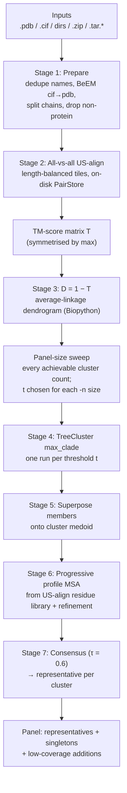

# How ColabAlign works

This document describes what ColabAlign [[1]](#ref-1) does, how each stage of the pipeline is implemented, and why the main design choices were made. It applies to **v1.2.3**.

---

## Contents

1. [Purpose](#1-purpose)
2. [Pipeline at a glance](#2-pipeline-at-a-glance)
3. [Stage 1: Input collection and structure preparation](#3-stage-1-input-collection-and-structure-preparation)
4. [Stage 2: All-vs-all structural alignment](#4-stage-2-all-vs-all-structural-alignment)
5. [Stage 3: Structural dendrogram](#5-stage-3-structural-dendrogram)
6. [Stage 4: Tree clustering](#6-stage-4-tree-clustering)
7. [Stage 5: Superposition onto the cluster medoid](#7-stage-5-superposition-onto-the-cluster-medoid)
8. [Stage 6: Structure-informed multiple sequence alignment](#8-stage-6-structure-informed-multiple-sequence-alignment)
9. [Stage 7: Consensus and representative selection](#9-stage-7-consensus-and-representative-selection)
10. [Outputs](#10-outputs)
11. [Parameters and defaults](#11-parameters-and-defaults)
12. [Computational cost](#12-computational-cost)
13. [Behaviour notes](#13-behaviour-notes)
14. [References](#14-references)

---

## 1. Purpose

ColabAlign selects a small panel of **structurally and sequentially diverse** proteins from a much larger set of structures (experimental or predicted). It answers this question: *if I can only test $k$ proteins in the lab, which $k$ cover the most structural diversity in my dataset?*

Sequence identity alone is a poor guide to this. In carbohydrate-binding modules (CBMs), for example, over 100 sequence families [[2]](#ref-2) fold into only about seven fold families [[3]](#ref-3), and family membership does not reliably predict substrate specificity. ColabAlign therefore groups proteins by **3D fold similarity** and then picks one representative per group, using a **structure-informed sequence alignment**.

At a high level, ColabAlign:

1. aligns every pair of structures with US-align [[4]](#ref-4) and records a TM-score;
2. builds a dendrogram from the resulting distance matrix;
3. cuts the dendrogram into clusters at one or more thresholds, given directly or chosen to give a requested panel size;
4. superposes each cluster's members onto a central structure (the medoid);
5. builds a structure-informed MSA for each cluster from the US-align residue correspondences;
6. selects the sequence closest to the cluster consensus as the representative;
7. assembles a panel from the representatives and singletons, topped up with the structures the panel covers least well.

All stages that can run in parallel are spread across CPU cores with `ProcessPoolExecutor`. This covers structure preparation, pairwise alignment and the per-cluster MSAs.

---

## 2. Pipeline at a glance



The code is organised as follows:

| Module | Role |
|---|---|
| `pipeline.py` | `ColabAlign` class; runs the stages in order and times each one |
| `cli.py` | Command-line arguments |
| `structure_prep.py` | Input discovery, archive extraction, duplicate-name handling, chain splitting |
| `usalign_runner.py` | Batching, US-align execution, output parsing, residue weights |
| `pair_store.py` | On-disk, versioned cache of per-pair alignment results |
| `dendrogram.py` | Tree construction, TreeCluster calls, medoid superposition |
| `consensus.py` | Per-cluster MSA, refinement, consensus and representative selection |
| `panel.py` | Panel-size sweep, threshold choice, low-coverage additions and panel files |
| `common.py` | Shared residue tables, PDB sequence extraction, multiprocessing context |

---

## 3. Stage 1: Input collection and structure preparation

**Module:** `structure_prep.py`

### 3.1 Discovery

Inputs to `-i` can be individual `.pdb`/`.cif` files, directories of them, or archives (`.zip`, `.tar`, `.tar.gz`/`.tgz`, `.tar.bz2`, `.tar.xz`).

- **Order:** loose files are taken first, in the order given to `-i` (with directory contents sorted alphabetically). Archive contents come after.
- **Safe extraction:** only `.pdb`/`.cif` members are extracted. macOS metadata (`__MACOSX/`, `._*`) and hidden files are skipped. Tar extraction uses the `data` filter, which rejects absolute paths, `..` escapes and links.
- **Same file given twice:** if the same file is reached by two routes (e.g. `-i dir dir/a.pdb`), it is included only once.

### 3.2 Unique names

Each structure's file stem becomes its label in the score matrix, tree and cluster files, so stems must be unique. The comparison ignores case and extension, so `model.pdb` and `MODEL.cif` clash.

- The first file with a given stem keeps its name.
- Later files with the same stem are aligned as `<stem>_dup1`, `<stem>_dup2`, and so on.
- Original files are never renamed. ColabAlign works on renamed copies, which are deleted once preparation finishes.
- Every clashing group is recorded in `results/duplicates.csv`, with one row per aligned chain. Each row includes a SHA-256 hash and an `identical_to` column that flags byte-identical inputs.

### 3.3 Conversion and chain splitting

Each input is converted into one PDB file per chain, named `<stem><chain>.pdb`.

- **`.cif` files** are converted with **BeEM** [[5]](#ref-5) (`-outfmt=2`). Each call runs in a private temporary directory, because BeEM writes into its working directory and parallel workers must not see each other's output.
- **`.pdb` files** are split by chain with Biopython's [[6]](#ref-6) `PDBParser`/`PDBIO`.
- **Name collisions between chain files** are resolved by content hash. A file with identical contents is treated as a re-run and left in place. A file with different contents is written under a `_dupN` name.

Inputs are divided into one chunk per core and processed in a worker pool. If one input fails, it is reported and skipped; the rest of its chunk carries on.

### 3.4 Filtering

The following chain files are removed before alignment, because US-align does not handle them properly:

- empty files;
- files with no residue from the 20 standard amino acids or selenomethionine (`MSE`). Both `ATOM` and `HETATM` records are checked, because `MSE` is conventionally written as `HETATM`.

With `-m first`, only the first chain of each input is kept.

### 3.5 Sequence extraction

Wherever a sequence is needed later, it is read directly from the coordinates. One residue is taken per unique residue number in the first chain, using C$\alpha$ atoms only. `HETATM` C$\alpha$ records are kept only for `MSE`, because a `HETATM` "CA" is usually a calcium ion. This makes the residue indices match exactly what US-align reads with `-het 2`, which matters for Stage 6.

---

## 4. Stage 2: All-vs-all structural alignment

**Modules:** `usalign_runner.py`, `pair_store.py`

### 4.1 TM-score

Structural similarity is measured with the template modelling score (TM-score) [[7]](#ref-7), as implemented in US-align [[4]](#ref-4). For a model aligned to a reference of length $L_\text{target}$:

$$
\mathrm{TM\text{-}score} \;=\; \max_{\text{superpositions}} \left[ \frac{1}{L_\text{target}} \sum_{i=1}^{L_\text{aligned}} \frac{1}{1 + \left( d_i / d_0(L_\text{target}) \right)^2} \right]
$$

$$
d_0(L) \;=\;
\begin{cases}
0.5\ \text{Å} & L \le 21 \\[4pt]
1.24\,\sqrt[3]{L - 15} \;-\; 1.8\ \text{Å} & L > 21
\end{cases}
$$

(The $L \le 21$ case follows US-align's protein distance-scale settings [[4]](#ref-4).)

Here, $d_i$ is the distance between the $i$-th pair of aligned C$\alpha$ atoms after optimal superposition, and $d_0$ is a length-dependent scale that makes scores comparable across protein sizes. TM-score lies in $(0, 1]$:

- $\mathrm{TM} \gtrsim 0.5$ indicates the same global fold [[8]](#ref-8);
- $\mathrm{TM} \lesssim 0.17$ is indistinguishable from a random pair [[7]](#ref-7).

There are three reasons for preferring TM-score to RMSD when comparing *different* proteins:

- **It is bounded and interpretable.** RMSD saturates at a value set by protein size: $\mathrm{RMSD}(v,w) \le \sqrt{R_g(v)^2 + R_g(w)^2}$, where $R_g$ is the radius of gyration [[9]](#ref-9).
- **It is comparable across lengths.** The normalisation by $d_0$ removes most of the length dependence, so one threshold works across a dataset of mixed lengths.
- **It is robust to poorly aligned regions.** Each residue pair contributes a bounded term, so disordered termini and other outliers cannot dominate the score. RMSD weights deviations by $d_i^2$ without limit.

### 4.2 Symmetrising the score

US-align returns two TM-scores for each pair: one normalised by each chain's length. ColabAlign keeps the higher of the two, which in practice is the one normalised by the shorter chain:

$$
T_{ij} \;=\; T_{ji} \;=\; \max\!\left(\mathrm{TM}_{i \to j},\; \mathrm{TM}_{j \to i}\right), \qquad T_{ii} = 1
$$

This produces the symmetric matrix $\mathbf{T}$, written to `results/us-align_score_matrix.csv`.

US-align is run with `-do -m - -het 2`:

| Flag | Effect |
|---|---|
| `-do` | Prints the distance of each aligned residue pair (used in Stage 6) |
| `-m -` | Prints the rotation/translation matrix (used in Stage 5) |
| `-het 2` | Also aligns `MSE` residues |

### 4.3 Number of alignments

Each unordered pair is aligned exactly once, so $n$ chains require

$$
P \;=\; \binom{n}{2} \;=\; \frac{n(n-1)}{2}
$$

alignments. The number of alignments grows as $\mathcal{O}(n^2)$. Using more cores reduces wall-clock time by a constant factor but does not change this growth.

### 4.4 Length-balanced batching ("tiles")

US-align run time grows roughly with $L_i L_j$, so pairs vary widely in cost. Simply splitting the pair list evenly across cores leaves some cores idle while others finish expensive pairs. ColabAlign instead estimates the cost of each pair as

$$
c(i,j) \;=\; L_i L_j + \kappa, \qquad \kappa = 1000 \ \text{residue}^2
$$

Here $L$ is the residue count from §3.5. File size is not used, because it is skewed by hydrogens, alternate conformations and waters. The constant $\kappa$ accounts for fixed per-pair overhead (about 2 ms of process start-up, compared with about 2 µs per residue$^2$ of alignment).

The pair list is then divided into tiles as follows:

1. **Canonical order.** Chains are sorted longest first, with ties broken by name. In each pair $(i, j)$ with $i < j$ in this order, chain $i$ is US-align's `Structure_1`. This fixed orientation means the cached results do not depend on how pairs were batched.
2. **Number of blocks.** ColabAlign chooses the smallest number of blocks $k$ such that the $k(k+1)/2$ resulting tiles reach a target count:
   $$
   \frac{k(k+1)}{2} \;\ge\; T^\star = \max\!\left(8\cdot\text{cores},\ \left\lceil P / 500 \right\rceil\right)
   $$
   This gives at least eight tiles per core for load balancing, and at most about 500 pairs per tile so the progress bar moves smoothly.
3. **Blocks.** The canonical order is cut into $k$ contiguous blocks with roughly equal total residue count $\sum L$.
4. **Tiles.** Each tile is either one block against itself or one block against a later block, so every pair is covered exactly once. A tile's cost is the sum of $c(i,j)$ over its pairs. For a block $B$ against itself:
   $$
   C_{BB} = \tfrac{1}{2}\!\left[\Big(\textstyle\sum_{i\in B} L_i\Big)^2 - \sum_{i\in B} L_i^2\right] + \kappa\binom{|B|}{2}
   $$
   For two different blocks $A$ and $B$:
   $$
   C_{AB} = \Big(\textstyle\sum_{A} L\Big)\Big(\textstyle\sum_{B} L\Big) + \kappa\,|A||B|
   $$
5. **Scheduling.** Tiles are submitted most expensive first. At most two tiles per worker are in flight at any time, which keeps memory use in the parent process bounded.

**List mode.** If every pair in a tile still needs computing and the tile's longest chain has at most 120 residues, the whole tile is run as a single US-align process (`-dir` or `-dir1`/`-dir2`). This saves the per-pair start-up cost, which matters for short chains (about 1.4× faster at 120 residues or fewer). Any pair that cannot be parsed from list-mode output is retried on its own.

### 4.5 Parsing and caching

Each US-align output is parsed into:

- the two directional TM-scores;
- the full chain lengths $L_a$ and $L_b$;
- the 3×4 superposition matrix $[\,\mathbf{t}\,|\,\mathbf{R}\,]$ and its inverse;
- the aligned residue-index pairs, each with a distance-based weight (see Stage 6).

Workers send only the TM-scores back to the parent process. The full result for each pair is written to disk as a pickle in `results/usalign_cache/`, named

```
v2_<sha256(file A)[:16]>_<sha256(file B)[:16]>.pkl
```

Writes are atomic (write to a temporary file, then rename). Because the cache key is built from file contents, re-running on the same structures reuses earlier alignments. The `v2_` prefix marks the current weighting scheme: caches written by older versions are ignored (not deleted) and recomputed.

### 4.6 Failures

A failed pair (no output, or output that cannot be parsed) is reported and left as `NaN` in the CSV. It is then set to $T_{ij} = 0$ (unrelated) for tree building, and a warning is printed. If an entire tile fails (for example, a worker crashes), only that tile's pairs are lost.

---

## 5. Stage 3: Structural dendrogram

**Module:** `dendrogram.py` (`grow_tree`)

### 5.1 Distance matrix

Similarities are converted to distances by subtracting from one:

$$
D_{ij} \;=\; \operatorname{clip}_{[0,1]}\!\Big(\operatorname{round}_4\big(1 - T_{ij}\big)\Big)
$$

Structurally similar pairs therefore have short distances and dissimilar pairs long ones. Values are rounded to four decimal places and clipped to $[0,1]$.

### 5.2 Tree construction

The tree is built with `Bio.Phylo.TreeConstruction.DistanceTreeConstructor.upgma`, an agglomerative method that works as follows:

1. Find the pair of clusters $(C_i, C_j)$ with the smallest distance $\delta = D(C_i, C_j)$. Ties go to the pair scanned last.
2. Join them under a new internal node at height $h = \delta/2$. Each child's branch length is $\delta/2$ minus that child's own height, so the tree is **ultrametric** (every leaf is the same distance from the root).
3. Recompute the distance from the merged cluster to every other cluster $C_k$, then repeat until one tree remains.

The textbook UPGMA [[10]](#ref-10) update weights each side by cluster size:

$$
D(C_i \cup C_j,\ C_k) \;=\; \frac{|C_i|\,D(C_i, C_k) + |C_j|\,D(C_j, C_k)}{|C_i| + |C_j|}
$$

However, Biopython [[6]](#ref-6) 1.88's `upgma` uses the **unweighted mean of the two sides**:

$$
D(C_i \cup C_j,\ C_k) \;=\; \tfrac{1}{2}\big[\,D(C_i, C_k) + D(C_j, C_k)\,\big]
$$

This is the WPGMA (McQuitty) update [[11]](#ref-11). The two give the same result whenever $|C_i| = |C_j|$; otherwise WPGMA gives more weight to the smaller cluster. In both cases the tree is ultrametric, branch lengths are non-negative, and each merge height is an average of the pairwise distances across the two merged groups.

The tree is written to `results/colabalign.tree` in Newick format.

### 5.3 Why a distance-based, ultrametric method

The reasons for this choice are:

- **Only a distance matrix is available.** Each pairwise structural alignment is reduced to a single number, so there are no position-by-position character states. Maximum-likelihood and Bayesian methods with a substitution matrix need those character states and are much more expensive. A distance method builds one tree directly, in polynomial time.
- **Neighbour-joining was rejected.** NJ [[12]](#ref-12) usually recovers topology better, but it can produce negative branch lengths when distances are not additive [[13]](#ref-13). TM-score distances are not guaranteed to be additive, and negative branches appeared in early testing. Its update step is also slower on large matrices.
- **Ultrametric trees suit threshold clustering.** In an ultrametric tree, the distance between two leaves along the tree is twice the height of their lowest common ancestor. That makes "cut the tree at $t$" mean the same thing everywhere in the tree (§6).

---

## 6. Stage 4: Tree clustering

**Module:** `dendrogram.py` (`tree_clustering`)

`TreeCluster.py` [[14]](#ref-14) is run once for each threshold $t$ (`-t`, default `0.20`), using its default method, **`max_clade`**. This method splits the leaves into the fewest clusters such that each cluster is a clade and

$$
\max_{u,v \,\in\, C}\ d_\text{tree}(u, v) \;\le\; t
$$

where $d_\text{tree}$ is the distance between two leaves along the tree's branches.

Because the tree is ultrametric with merge heights $h = \delta/2$, the tree distance between $u$ and $v$ equals $\delta$ at their lowest common ancestor. The largest tree distance within a clade is therefore the $\delta$ at the clade's root, and the condition becomes:

> **A clade is a cluster if the merge distance at its root is at most $t$**. Equivalently, its linkage-averaged TM-score is at least $1 - t$.

The default $t = 0.20$ therefore corresponds to an average-linkage TM-score of about 0.80. Because the merge distance is an *average*, some individual pairs within a cluster can have $T_{ij} < 1 - t$.

TreeCluster labels any leaf that ends up in a cluster of size one with **`-1`**, so cluster `-1` is the set of all singletons. The output for each threshold is written to `results/clusters/<t>.tsv`.

### 6.1 Choosing $t$ from a panel size

With `-n/--panel-size`, ColabAlign chooses $t$ itself. Each internal node $v$ of the tree has a diameter $\Delta_v$, the largest leaf-to-leaf distance within its clade, computed exactly as TreeCluster computes it from the written Newick file. Diameters never decrease towards the root, so at threshold $t$ the number of clusters (counting each singleton as one) is

$$
K(t) \;=\; n \;-\; \sum_{v:\ \Delta_v \le t} \big(\text{children}(v) - 1\big).
$$

Sweeping the sorted diameters lists every cluster count the tree can give, and the range of $t$ that gives it, without running TreeCluster for each candidate. The panel size for $K$ clusters is $K + a(K)$, where $a(K)$ is the number of low-coverage additions (§9.3). For each request:

- **`-n N`** uses the cut whose panel size is closest to $N$. On a tie, the smaller panel wins.
- **`-n MIN-MAX`** uses every cut whose panel size lies in the range. If none does, it uses the closest one.

Not every size is possible: one merge in the tree can join several clusters at once, so the result can differ from the number requested. The threshold passed to TreeCluster is the shortest decimal (at least two places) inside the chosen range of $t$, as near its middle as that precision allows. After clustering, the cluster count is checked against the prediction, and a warning is printed if they differ. Every achievable panel size, with its range of $t$, is written to `results/panel_sizes.csv` on every run, so it can be used to pick sizes for a re-run. `-t` and `-n` can be combined; without either, $t = 0.20$.

---

## 7. Stage 5: Superposition onto the cluster medoid

**Module:** `dendrogram.py` (`_process_cluster`)

For each cluster $C$ other than `-1`, ColabAlign chooses a reference structure, the **medoid**: the member with the highest *mean* TM-score to the rest of the cluster.

$$
m \;=\; \arg\max_{i \in C}\ \frac{1}{|C|} \sum_{j \in C} T_{ij}
$$

(The sum includes $T_{ii} = 1$, which adds the same amount to every member and so does not change the result.) Using the mean avoids choosing an atypical member that happens to have a single very close neighbour.

Every other member is then placed in the medoid's frame using the superposition matrix that US-align already computed for that pair (retrieved from the PairStore). Each atom, including every alternate conformation, is transformed as

$$
\mathbf{x}' \;=\; \mathbf{R}\,\mathbf{x} + \mathbf{t}
$$

If the cached alignment was run in the opposite direction (the medoid was `Structure_1`), the inverse transform is used:

$$
\mathbf{R}^{-1} = \mathbf{R}^{\mathsf T}, \qquad \mathbf{t}^{-1} = -\mathbf{R}^{\mathsf T}\mathbf{t}
$$

The superposed PDB files are written to `results/clusters/<t>/<cluster>/`. With `--no-superpose` this stage is skipped. A cluster that appears unchanged at several thresholds is superposed once, and its files are copied to the other thresholds. Singletons (cluster `-1`) have no medoid, so they are copied to `results/clusters/<t>/-1/` unchanged.

---

## 8. Stage 6: Structure-informed multiple sequence alignment

**Module:** `consensus.py` (`build_cluster_alignment`)

Each cluster (except `-1`) is aligned as a separate job, and all clusters from all thresholds share one worker pool. A job loads only its own slice of $\mathbf{T}$ and only the PairStore entries for pairs within the cluster.

The method is a **progressive, library-based profile alignment**. Instead of scoring columns with an amino-acid substitution matrix, it scores them by how strongly **US-align superposed those residues onto each other**. The resulting MSA therefore reflects structural correspondence rather than sequence similarity.

### 8.1 Residue-pair library

For each pair of structures $(a, b)$ in the cluster, US-align provides a set of aligned residue pairs $\mathcal{L}_{ab} = \{(r_k, s_k, w_k)\}$. Each pair is weighted by its post-superposition C$\alpha$ distance $d_k$ (from `-do`), using the TM-score kernel:

$$
w_k \;=\; \frac{1}{1 + \left( d_k / d_0(L_{\min}) \right)^2}, \qquad L_{\min} = \min(L_a, L_b)
$$

Here $L_a$ and $L_b$ are the **full** chain lengths reported by US-align, not the number of aligned pairs. $d_0$ is defined as in §4.1. Each weight lies in $(0, 1]$ and is **not** divided by chain length. These weights set the MSA's scoring scale only; they do not change the TM-score matrix, the tree or the clusters.

If the distance table is missing or its length does not match the aligned pairs, ColabAlign falls back to US-align's match symbols: $w_k = 1.0$ for `:` (distance under 5 Å) and $w_k = 0.5$ for `.` (other aligned pairs). If a chain length is missing or not positive, the pair fails instead of silently using a different scale.

### 8.2 Guide tree

The order in which sequences are merged is set by a guide tree built from the cluster's own TM-scores. It uses SciPy's [[15]](#ref-15) `scipy.cluster.hierarchy.linkage(method="average")`, which is true size-weighted UPGMA, on $D_{ij} = \max(0,\ 1 - T_{ij})$.

### 8.3 Profiles and the column score matrix

A **profile** is a list of columns. Each column maps a structure ID to the index of its residue in that column (structures with a gap in that column are simply absent). At the start, each structure is its own profile with one column per residue.

To align profile $A$ (with $n$ columns) to profile $B$ (with $m$ columns), ColabAlign builds a score matrix $\mathbf{S} \in \mathbb{R}^{n \times m}$. Entry $S_{pq}$ adds up the library weights of every residue pair that would be placed together if column $p$ of $A$ were aligned with column $q$ of $B$:

$$
S_{pq} \;=\; \sum_{a \in A}\ \sum_{b \in B}\ \sum_{(r,s,w)\, \in\, \mathcal{L}_{ab}} w \cdot \mathbb{1}\!\left[\pi_A(a, r) = p\right] \cdot \mathbb{1}\!\left[\pi_B(b, s) = q\right]
$$

Here $\pi_A(a, r)$ is the column of profile $A$ that holds residue $r$ of structure $a$. $\mathbf{S}$ is not divided by profile size, so larger subtrees contribute proportionally more evidence.

### 8.4 Affine-gap alignment (Gotoh)

The two profiles are aligned globally with Gotoh's [[16]](#ref-16) three-state dynamic programming algorithm. The three states are $M$ (column aligned with column), $X$ (gap in $B$) and $Y$ (gap in $A$):

$$
\begin{aligned}
M_{i,j} &= \max\{M_{i-1,j-1},\ X_{i-1,j-1},\ Y_{i-1,j-1}\} + S_{i,j} \\
X_{i,j} &= \max\{M_{i-1,j} - g_o,\ X_{i-1,j} - g_e\} \\
Y_{i,j} &= \max\{M_{i,j-1} - g_o,\ Y_{i,j-1} - g_e\}
\end{aligned}
$$

The gap-open penalty is $g_o = 6$ and the gap-extension penalty is $g_e = 1$, so a gap of length $\ell$ costs $g_o + (\ell - 1)\,g_e$. The boundary conditions are

$$
M_{0,0} = 0, \qquad X_{i,0} = -g_o - (i-1)\,g_e, \qquad Y_{0,j} = -g_o - (j-1)\,g_e
$$

so gaps at the ends are penalised the same as internal gaps. Traceback starts from the best of the three states at $(n, m)$, and the aligned or gapped column pairs are combined into one merged profile. The run time is $\mathcal{O}(nm)$.

### 8.5 Iterative refinement

Progressive alignment cannot undo an early mistake, so for clusters of three or more structures the root profile is refined. The quantity being improved is the **sum-of-pairs library score**: the total weight of every library residue pair that ends up in the same column of the MSA $\mathcal{A}$.

$$
\Phi(\mathcal{A}) \;=\; \sum_{a < b}\ \sum_{(r,s,w) \,\in\, \mathcal{L}_{ab}} w \cdot \mathbb{1}\!\left[\,r \text{ and } s \text{ share a column of } \mathcal{A}\,\right]
$$

Each refinement pass takes every structure in turn and:

1. removes it from the MSA (dropping any columns that become empty);
2. re-aligns it to the rest of the MSA using §8.3–8.4;
3. keeps the new MSA only if $\Phi$ strictly increases.

Refinement stops after a pass with no improvement, or after three passes.

The final MSA is written as `threshold_<t>_cluster_<c>.afasta`.

---

## 9. Stage 7: Consensus and representative selection

**Module:** `consensus.py` (`build_consensus`, `find_nearest_sequence`)

### 9.1 MView-style consensus

The consensus follows the residue groups used by MView [[17]](#ref-17).

For each MSA column $k$, let $G_k$ be the multiset of non-gap residues in that column, and set the consensus threshold to $\tau = 0.6$. The consensus symbol $c_k$ is chosen as follows:

1. If the most common residue $x^\star$ satisfies $f_{G_k}(x^\star) \ge \tau$, then $c_k = x^\star$.
2. Otherwise, $c_k$ is the **first** physicochemical group $g$, in the priority order below, for which $\dfrac{|\{x \in G_k : x \in g\}|}{|G_k|} \ge \tau$.
3. Otherwise, $c_k = \texttt{.}$ (no consensus).

| Priority | Group | Symbol | Residues |
|---|---|---|---|
| 1 | Alcohol | `o` | S T |
| 2 | Aliphatic | `l` | I L V |
| 3 | Aromatic | `a` | F H W Y |
| 4 | Charged | `c` | D E H K R |
| 5 | Hydrophobic | `h` | A C F G H I K L M R T V W Y |
| 6 | Negative | `-` | D E |
| 7 | Polar | `p` | C D E H K N Q R S T |
| 8 | Positive | `+` | H K R |
| 9 | Small | `s` | A C D G N P S T V |
| 10 | Tiny | `u` | A G S |
| 11 | Turn-like | `t` | A C D E G H K N Q R S T |

Because groups are tested in this fixed order, a group never wins if it is a subset of a group checked earlier. Negative ($\subset$ Charged), Positive ($\subset$ Charged) and Tiny ($\subset$ Small) are therefore never emitted, and the symbols that can actually appear are `o l a c h p s t`.

The consensus is written to `threshold_<t>_cluster_<c>_consensus.afasta`.

### 9.2 Representative scoring

Each aligned sequence $x^{(r)}$ is scored against the consensus, position by position, over the full alignment length $N$ (gap columns included):

$$
\operatorname{score}(r) \;=\; \sum_{k=1}^{N} \sigma\!\left(c_k,\ x^{(r)}_k\right),
\qquad
\sigma(c, x) =
\begin{cases}
+1 & c = \texttt{.} \text{ and } x = \texttt{-} \\
+1 & c = x \\
+1 & c \text{ is a group symbol and } x \in c \\
-1 & \text{otherwise}
\end{cases}
$$

The representative is the highest-scoring sequence:

$$
\hat r = \arg\max_r\ \operatorname{score}(r)
$$

If several sequences tie, the first in alphabetical order of structure name wins. The highest possible score is $N$. Each cluster's representative is written, with gaps removed and a header of the form `Cluster c: name (alignment score s/N)`, to

```
results/clusters/<t>/threshold_<t>_cluster_representatives.fasta
```

### 9.3 Panel assembly and low-coverage additions

**Module:** `panel.py`

The panel for threshold $t$ starts with one structure per cluster: each cluster's representative and every singleton. If a cluster has no representative, its medoid is used and a warning is printed. Call this set $P$ and its size $K$.

The **coverage** of structure $i$ is its best TM-score to any panel member, $c_i = \max_{j \in P} T_{ij}$, so panel members have $c_i = 1$. Because clusters are defined by linkage averages (§6), some members of large clusters can be poorly matched by their representative. The panel is topped up with $a$ of them, farthest-first: add $\arg\min_{i \notin P} c_i$, update every $c_i$, and repeat. Updating after each addition stops two near-identical outliers both being added. Ties go to the first name alphabetically.

`-l/--low-coverage-fraction` sets the share $f$ of the final panel given to these additions (default 0.05):

$$
a(K) \;=\; \min\!\left(\left\lfloor \frac{f K}{1 - f} + \tfrac12 \right\rfloor,\ n - K\right),
$$

so that $a / (K + a) \approx f$. With $f = 0.05$, a 57-cluster cut gets 3 additions (panel of 60) and a cut with 9 or fewer clusters gets none. `-l 0` turns this off.

For each threshold, the panel is written to `clusters/<t>/threshold_<t>_panel.csv` (one row per member: role, cluster, cluster size, how many structures it is the best match for, and, for additions, its coverage when it was added) and `threshold_<t>_panel.fasta`. `results/panels.csv` summarises every panel: its size, composition, and the mean, 10th percentile and minimum of $c_i$ over all $n$ structures. Panel members are included in these, with $c_i = 1$.

---

## 10. Outputs

```
<output>/
├── models/                         single-chain PDBs actually aligned
└── results/
    ├── duplicates.csv              name-clash report (header only if none)
    ├── us-align_score_matrix.csv   symmetric TM-score matrix T (NaN = failed pair)
    ├── colabalign.tree             Newick dendrogram
    ├── panel_sizes.csv             every achievable panel size and its thresholds
    ├── panels.csv                  one row per panel: size, composition, coverage
    ├── usalign_cache/              v2_*.pkl per-pair results (reusable between runs)
    └── clusters/
        ├── <t>.tsv                 TreeCluster assignments (-1 = singleton)
        └── <t>/
            ├── threshold_<t>_panel.csv     panel members, roles and coverage
            ├── threshold_<t>_panel.fasta   panel sequences
            ├── threshold_<t>_cluster_representatives.fasta
            ├── -1/                 singletons, copied unchanged
            └── <c>/
                ├── *.pdb           members superposed onto the medoid
                ├── threshold_<t>_cluster_<c>.afasta
                └── threshold_<t>_cluster_<c>_consensus.afasta
```

---

## 11. Parameters and defaults

| Flag | Default | Meaning |
|---|---|---|
| `-i/--input` | (required) | Files, directories or archives |
| `-o/--output` | (required) | Output directory (created if missing) |
| `-c/--cores` | 2 | Worker processes. Values below 1 are raised to 1; values above `cpu_count()` are capped |
| `-n/--panel-size` | none | One or more panel sizes, each `N` (closest achievable) or `MIN-MAX` (every achievable size in the range); $t$ is chosen for each (§6.1) |
| `-t/--threshold` | 0.20 if no `-n` | One or more `max_clade` thresholds $t \in [0.01, 1]$; a cluster's linkage-level TM-score is at least $1 - t$ |
| `-l/--low-coverage-fraction` | 0.05 | Share of each panel given to low-coverage additions, from 0 to 0.5 (§9.3) |
| `--no-superpose` | off | Skip Stage 5: no structure files are written to `clusters/`, and the MSAs read sequences from `models/` instead. Representatives, alignments and panels are identical |
| `-m/--mode` | `all` | `all` chains, or only the `first` chain of each input |
| `-u/--usalign` | `USalign` | Path to the US-align executable |
| `-b/--beem` | `BeEM` | Path to BeEM (only needed for `.cif` inputs) |

The Colab notebook's threshold slider defaults to 0.12, which is stricter than the CLI default.

These internal constants are not exposed as options:

| Constant | Value | Where |
|---|---|---|
| Per-pair overhead $\kappa$ | 1000 residue$^2$ | Tile cost model |
| Tiles per core | 8 | Batching |
| Target pairs per tile | 500 | Batching |
| List-mode length cut-off | 120 residues | Batching |
| In-flight tiles per worker | 2 | Scheduling |
| Gap open / extend $g_o, g_e$ | 6 / 1 | Profile alignment |
| Refinement passes | at most 3 | MSA refinement |
| Consensus threshold $\tau$ | 0.6 | Consensus |

---

## 12. Computational cost

| Stage | Cost |
|---|---|
| Pairwise alignment | $\binom{n}{2}$ US-align runs; total work $\approx \sum_{i<j}\big(\alpha L_i L_j + \beta\big)$, divided over $p$ cores |
| Dendrogram | Biopython's implementation rescans the matrix at every merge, giving $\mathcal{O}(n^3)$ time and $\mathcal{O}(n^2)$ memory |
| MSA (per cluster $C$) | $\lvert C\rvert - 1$ progressive merges, plus up to $3\lvert C\rvert$ refinement merges, each $\mathcal{O}(nm)$ plus library look-ups |

In practice the pairwise alignment stage dominates. Its quadratic growth becomes the main bottleneck once inputs go well beyond about 1,000 structures. Generating structures beforehand is a further, larger upstream cost: for example, predicting 1,000 CBM structures with AlphaFold2 [[18]](#ref-18) took about 10 days on 2× V100 GPUs.

Two possible future directions:

- **Faster alignment.** Replacing coordinate-based alignment with 3Di-alphabet alignment (Foldseek [[19]](#ref-19), FoldMason [[20]](#ref-20)) would cost $\mathcal{O}(mn)$ per pair, with SIMD acceleration available [[21]](#ref-21). FoldMason's guide-tree branch lengths, however, reflect merge order rather than structural distance, so a separate step would be needed to recover pairwise distances before clustering.
- **Skipping structure prediction.** ProstT5 [[22]](#ref-22) converts sequence directly to 3Di (about 100× faster than AlphaFold2 on the 1,000-CBM set), which would remove the folding step.

---

## 13. Behaviour notes

These are properties of the current implementation that affect how the results should be read.

- **The tree uses WPGMA, not size-weighted UPGMA.** As described in §5.2, Biopython's `upgma` averages the two merged sides equally. The per-cluster guide tree (§8.2) *does* use size-weighted UPGMA.
- **Missing pairs are treated as unrelated.** A failed alignment is set to $T = 0$ ($D = 1$). This can separate structures that would otherwise cluster together, so check the warning list after each run.
- **Singletons are not in the representatives file.** Cluster `-1` is skipped in Stages 6 and 7, so `threshold_<t>_cluster_representatives.fasta` lists only clusters with two or more members. Each singleton is its own representative and can be found in `clusters/<t>/-1/`. The panel files (§9.3) include singletons.
- **Clusters shared between thresholds are aligned once.** When several thresholds give a cluster with the same members, as nearby thresholds in a `-n MIN-MAX` sweep usually do, its MSA is built once and the files are copied under each threshold's names.
- **The consensus ignores how many sequences have a gap.** In §9.1, $\tau$ is measured over non-gap residues only. In a column where a single sequence has an insertion, that residue is 100 % of $G_k$ and becomes the consensus symbol, so the sequence with the insertion gains +1 there and every gapped sequence loses 1. Representative selection can therefore favour sequences with unique insertions.
- **Thresholds are linkage averages.** §6 explains why some individual pairs within a cluster can fall below $1 - t$.

---

## 14. References

1. <a id="ref-1"></a>[10.1101/2025.10.06.677802](https://doi.org/10.1101/2025.10.06.677802) ; [10.5281/zenodo.14169501](https://doi.org/10.5281/zenodo.14169501)
2. <a id="ref-2"></a>[10.1093/nar/gkab1045](https://doi.org/10.1093/nar/gkab1045)
3. <a id="ref-3"></a>[10.1042/BJ20040892](https://doi.org/10.1042/BJ20040892)
4. <a id="ref-4"></a>[10.1038/s41592-022-01585-1](https://doi.org/10.1038/s41592-022-01585-1)
5. <a id="ref-5"></a>[10.1186/s12859-023-05388-9](https://doi.org/10.1186/s12859-023-05388-9)
6. <a id="ref-6"></a>[10.1093/bioinformatics/btp163](https://doi.org/10.1093/bioinformatics/btp163)
7. <a id="ref-7"></a>[10.1002/prot.20264](https://doi.org/10.1002/prot.20264)
8. <a id="ref-8"></a>[10.1093/bioinformatics/btq066](https://doi.org/10.1093/bioinformatics/btq066)
9. <a id="ref-9"></a>Reva, B. A., Finkelstein, A. V. & Skolnick, J. — *What is the probability of a chance prediction of a protein structure with an rms deviation of 6 Å?*
10. <a id="ref-10"></a>Sokal, R. R. & Michener, C. D. — *A statistical method for evaluating systematic relationships*
11. <a id="ref-11"></a>McQuitty, L. L. — *Similarity analysis by reciprocal pairs for discrete and continuous data*
12. <a id="ref-12"></a>[10.1093/oxfordjournals.molbev.a040454](https://doi.org/10.1093/oxfordjournals.molbev.a040454)
13. <a id="ref-13"></a>[10.1093/molbev/msh049](https://doi.org/10.1093/molbev/msh049)
14. <a id="ref-14"></a>[10.1371/journal.pone.0221068](https://doi.org/10.1371/journal.pone.0221068)
15. <a id="ref-15"></a>[10.1038/s41592-019-0686-2](https://doi.org/10.1038/s41592-019-0686-2)
16. <a id="ref-16"></a>[10.1016/0022-2836(82)90398-9](https://doi.org/10.1016/0022-2836%2882%2990398-9)
17. <a id="ref-17"></a>[10.1093/bioinformatics/14.4.380](https://doi.org/10.1093/bioinformatics/14.4.380)
18. <a id="ref-18"></a>[10.1038/s41586-021-03819-2](https://doi.org/10.1038/s41586-021-03819-2)
19. <a id="ref-19"></a>[10.1038/s41587-023-01773-0](https://doi.org/10.1038/s41587-023-01773-0)
20. <a id="ref-20"></a>[10.1126/science.ads6733](https://doi.org/10.1126/science.ads6733)
21. <a id="ref-21"></a>[10.1371/journal.pone.0082138](https://doi.org/10.1371/journal.pone.0082138)
22. <a id="ref-22"></a>[10.1093/nargab/lqae150](https://doi.org/10.1093/nargab/lqae150)
